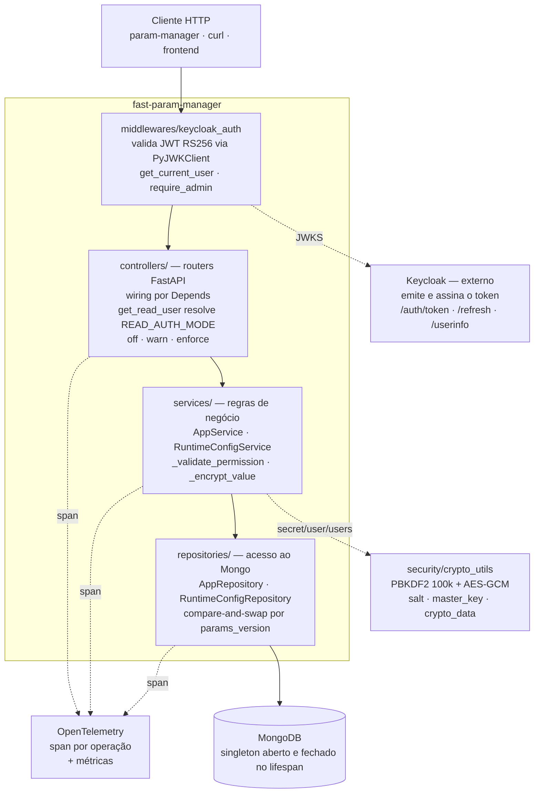

# Visão geral da API

`fast-param-manager` é o servidor do produto: uma API FastAPI sobre MongoDB, com
autenticação delegada ao Keycloak e instrumentação OpenTelemetry de ponta a
ponta.

## Responsabilidades

| Faz | Não faz |
|---|---|
| Guarda parâmetros agrupados por aplicação | Não notifica ninguém quando um valor muda |
| Valida o valor contra o tipo declarado | Não converte tipo automaticamente |
| Cifra `secret`, `user` e `users` | Não guarda histórico de valores |
| Autoriza escrita por papel | Não protege leitura por padrão |
| Emite spans e métricas de toda operação | Não negocia versão de cliente |

## Superfície pública

Três grupos de rotas, com regimes de acesso diferentes:

| Prefixo | Para que serve | Quem entra |
|---|---|---|
| `/auth` | Emissão e renovação de token, dados do usuário | Aberto para emitir, autenticado para `userinfo` |
| `/parameters` | O CRUD de aplicações e parâmetros | Varia por rota — ver [Endpoints](endpoints.md) |
| `/admin` | Configuração em runtime | Só administrador |

O detalhe rota a rota, com corpo de requisição e de resposta, está em
[Endpoints](endpoints.md).

## Modelo de dados

Uma **aplicação** é um documento; os **parâmetros** são um mapa dentro dele.
Cada parâmetro carrega o valor mais os metadados que governam a validação:

```json
{
  "value": "postgres://...",
  "description": "String de conexão do banco de relatórios",
  "type": "secret",
  "user_editable": false,
  "min_length": 0,
  "max_length": 30,
  "min_value": 0,
  "max_value": 1000000,
  "referenced_params": null
}
```

!!! warning "Os defaults dos limites surpreendem"

    `max_length` vale **30** por padrão e `min_value` vale **0**. Isso significa
    que uma string de 40 caracteres é rejeitada e que um número negativo é
    rejeitado — em ambos os casos sem ninguém ter configurado nada. Os limites
    são detalhados em [Tipos de parâmetro](tipos-de-parametro.md#limites).

Na leitura, cada parâmetro volta enriquecido com auditoria: `created_at`,
`created_by`, `updated_at` e `updated_by`.

## Como uma requisição atravessa a API

O servidor é estritamente em camadas, e a regra que sustenta tudo é uma só:
**o controller nunca toca no banco.**



Cada camada tem uma responsabilidade que as outras não têm licença para assumir:
toda regra de negócio está em `services/`, todo acesso a dados em
`repositories/`, e o controller apenas traduz HTTP em chamada de negócio. O
detalhamento de cada camada, com o contrato de teste que a injeção por `Depends`
cria, está em [Arquitetura](../produto/arquitetura.md).

O portão de acesso de cada rota — `leitura`, `token` ou `admin` — está na tabela
de [Endpoints](endpoints.md).

## Versões que não batem

Um aviso honesto para quem for empacotar ou liberar: hoje existem **três
declarações de versão que discordam entre si** no repositório do servidor.

| Onde | Valor |
|---|---|
| `pyproject.toml` | `0.1.0` |
| `CHANGELOG.md` | `2.0.0` |
| `API_VERSION` e `service.version` nos traces | `2.0.0` |

Além disso, o `CHANGELOG.md` foi escrito à mão num formato que não corresponde
ao `title_format` configurado, e o towncrier **nunca rodou** neste projeto.
Rodar `towncrier build` sem resolver isso antes produz um changelog corrompido.
