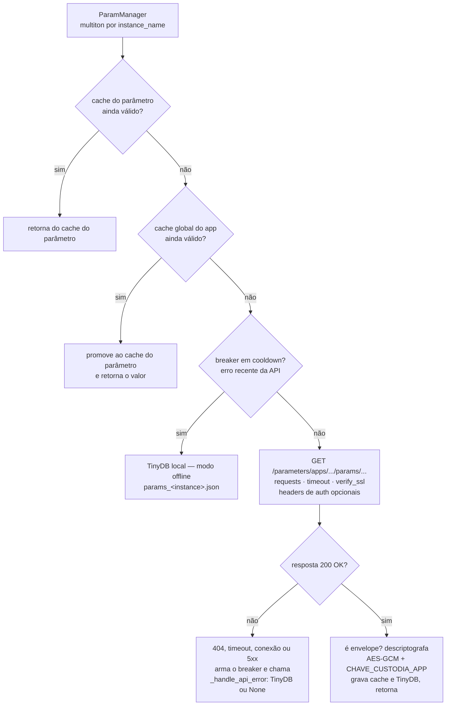
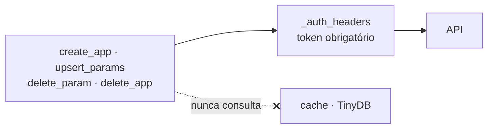

# Visão geral do cliente

`param-manager` é a biblioteca Python que consome a API. Está publicada no PyPI
na versão **0.4.3** e é instalada dentro da sua aplicação.

```python
from param_manager import ParamManager

pm = ParamManager.get_instance()
timeout = pm.get_param('MEU_APP', 'TIMEOUT_HTTP')
```

## O que ela resolve

Ler configuração de um serviço remoto cria uma dependência nova no caminho
crítico da sua aplicação. A biblioteca existe para que essa dependência
**degrade em vez de falhar**:

- **Cache em dois níveis**, para que a maioria das leituras nem toque na rede.
- **Circuit breaker**, para parar de bater num servidor que está doente.
- **Cópia local em TinyDB**, que responde quando a API não responde.
- **Decifragem transparente** dos parâmetros sensíveis.

O preço disso é que o valor que você lê pode estar velho. Quanto, é você quem
decide — ver [Cache e modo offline](cache-e-offline.md).

## Como uma leitura é resolvida

A cadeia abaixo é percorrida até algum degrau responder. A ordem não é
acidental: cada degrau custa mais que o anterior, e o último existe para que a
ausência da API seja **degradação**, e não falha.



A escrita não tem nada disso. Ela sempre vai à rede, sempre com token, e nunca
consulta o cache:



O detalhamento de cada degrau — validade do cache, o que arma e o que desarma o
breaker, e o que acontece em cada modo de falha — está em
[Cache e modo offline](cache-e-offline.md).

## Multiton, não singleton

`ParamManager` **não** é um singleton. É um *multiton*: uma instância por
`instance_name`, guardadas num dicionário de classe protegido por lock.

```python
producao = ParamManager.get_instance(instance_name='producao')
homolog  = ParamManager.get_instance(instance_name='homolog')
```

As duas têm URL, credencial, cache e arquivo local independentes.

!!! warning "A documentação antiga da biblioteca diz 'Singleton'"

    O `README` do `param-manager` e páginas antigas do site dele afirmam que a
    classe implementa o padrão Singleton, com `__instance` e cache de uma hora.
    Isso descreve uma versão que não existe mais. O que vale é o que está aqui.

`__init__` retorna cedo quando a instância já foi inicializada, então construir
`ParamManager(instance_name='x')` duas vezes devolve o mesmo objeto sem refazer
nada.

## A superfície pública

O pacote exporta exatamente dois nomes:

```python
from param_manager import ParamManager, ParamNaoEncontradoError
```

### Leitura

| Método | Devolve |
|---|---|
| `get_param(app_name, param_name, save_cache=True)` | O valor, já decifrado |
| `get_all_params(app_name)` | Mapa de nome para valor |

### Escrita

| Método | Observação |
|---|---|
| `create_app(name, description=None)` | Espera `201` do servidor |
| `upsert_params(app_name, param_name, *, value, param_type, ...)` | Um parâmetro por chamada |
| `delete_param(app_name, param_name)` | |
| `delete_app(app_name)` | |

Escrita **sempre** vai à rede, sempre com token, e nunca consulta cache.

### Cache

| Método | Observação |
|---|---|
| `clear_cache(app_name=None, param_name=None)` | Sem argumento, limpa tudo |
| `get_cache_info()` | Estado dos caches, validade e marcas de erro |

!!! note "Métodos que a documentação antiga promete e não existem"

    `update_param(...)` e `get_param_schema(...)` aparecem no tutorial do site
    do `param-manager`. **Nenhum dos dois existe.** Para alterar um valor, use
    `upsert_params`.

## Versões de Python

`requires-python = ">=3.10,<=3.14"`.

O piso subiu de 3.8 para 3.10 **por segurança, não por sintaxe**:
`python-dotenv==1.2.2` corrige a PYSEC-2026-2270 e não é publicado abaixo de
3.10. Em 3.9 o teto alcançável ainda é vulnerável; em 3.8, pior. Baixar o piso
significa voltar a distribuir a falha.
