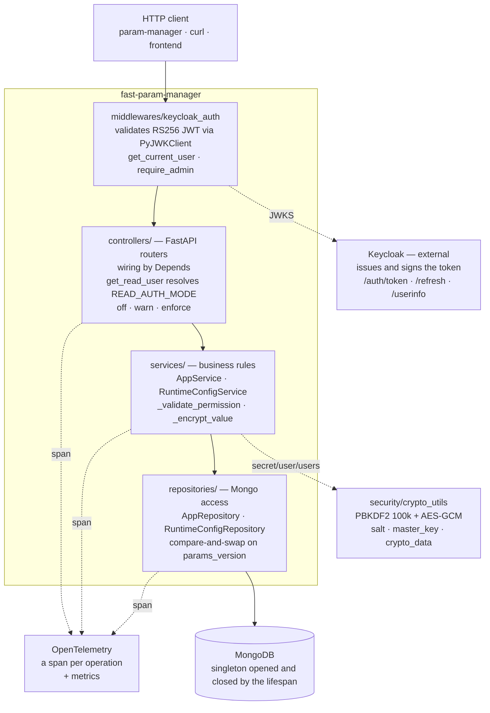

# API overview

`fast-param-manager` is the product's server: a FastAPI application over
MongoDB, with authentication delegated to Keycloak and end-to-end OpenTelemetry
instrumentation.

## Responsibilities

| Does | Does not |
|---|---|
| Stores parameters grouped by application | Notify anyone when a value changes |
| Validates the value against its declared type | Coerce types automatically |
| Encrypts `secret`, `user` and `users` | Keep a history of values |
| Authorizes writes by role | Protect reads by default |
| Emits spans and metrics for every operation | Negotiate client versions |

## Public surface

Three route groups, with different access regimes:

| Prefix | Purpose | Who gets in |
|---|---|---|
| `/auth` | Token issue and refresh, user info | Open to issue, authenticated for `userinfo` |
| `/parameters` | The application and parameter CRUD | Varies per route — see [Endpoints](endpoints.md) |
| `/admin` | Runtime configuration | Admin only |

The route-by-route detail, with request and response bodies, is in
[Endpoints](endpoints.md).

## Data model

An **application** is a document; the **parameters** are a map inside it. Each
parameter carries the value plus the metadata that governs validation:

```json
{
  "value": "postgres://...",
  "description": "Connection string for the reporting database",
  "type": "secret",
  "user_editable": false,
  "min_length": 0,
  "max_length": 30,
  "min_value": 0,
  "max_value": 1000000,
  "referenced_params": null
}
```

!!! warning "The bound defaults are surprising"

    `max_length` defaults to **30** and `min_value` defaults to **0**. That
    means a 40-character string is rejected and a negative number is rejected —
    in both cases without anyone having configured anything. The bounds are
    detailed in [Parameter types](tipos-de-parametro.md#limits).

On read, each parameter comes back enriched with audit metadata: `created_at`,
`created_by`, `updated_at` and `updated_by`.

## How a request crosses the API

The server is strictly layered, and one rule holds everything together:
**the controller never touches the database.**



Each layer owns something the others are not licensed to take over: every
business rule lives in `services/`, every data access in `repositories/`, and
the controller merely translates HTTP into a business call. The per-layer
detail, including the test contract that `Depends` injection creates, is in
[Architecture](../produto/arquitetura.md).

The access gate for each route — `read`, `token` or `admin` — is in the
[Endpoints](endpoints.md) table.

## Versions that disagree

An honest warning for anyone about to package or release: there are currently
**three version declarations that contradict each other** in the server
repository.

| Where | Value |
|---|---|
| `pyproject.toml` | `0.1.0` |
| `CHANGELOG.md` | `2.0.0` |
| `API_VERSION` and `service.version` in traces | `2.0.0` |

On top of that, `CHANGELOG.md` was hand-written in a format that does not match
the configured `title_format`, and towncrier has **never run** on this project.
Running `towncrier build` without resolving that first produces a corrupted
changelog.
