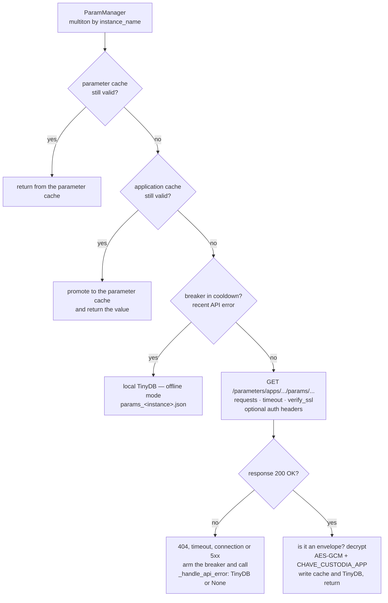
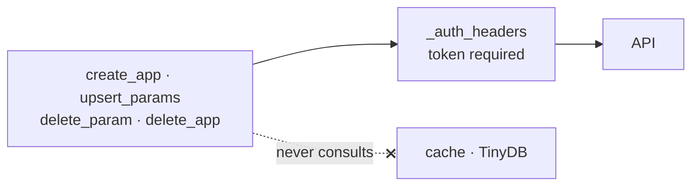

# Client overview

`param-manager` is the Python library that consumes the API. It is published on
PyPI at version **0.4.3** and installed inside your application.

```python
from param_manager import ParamManager

pm = ParamManager.get_instance()
timeout = pm.get_param('MY_APP', 'TIMEOUT_HTTP')
```

## What it solves

Reading configuration from a remote service adds a new dependency to your
application's critical path. The library exists so that dependency **degrades
instead of failing**:

- **Two-level cache**, so most reads never touch the network.
- **Circuit breaker**, to stop hammering a server that is sick.
- **Local TinyDB copy**, which answers when the API does not.
- **Transparent decryption** of sensitive parameters.

The price is that the value you read may be stale. How stale is your call — see
[Cache and offline mode](cache-e-offline.md).

## How a read is resolved

The chain below is walked until one step answers. The order is not accidental:
each step costs more than the previous one, and the last one exists so that the
absence of the API is **degradation** rather than failure.



Writes have none of this. They always hit the network, always with a token, and
never consult the cache:



The detail of each step — cache validity, what arms and what disarms the
breaker, and what happens in each failure mode — is in
[Cache and offline mode](cache-e-offline.md).

## Multiton, not singleton

`ParamManager` is **not** a singleton. It is a *multiton*: one instance per
`instance_name`, held in a class dictionary guarded by a lock.

```python
production = ParamManager.get_instance(instance_name='producao')
staging    = ParamManager.get_instance(instance_name='homolog')
```

The two have independent URLs, credentials, caches and local files.

!!! warning "The library's old documentation says 'Singleton'"

    The `param-manager` `README` and older pages on its site claim the class
    implements the Singleton pattern, with `__instance` and a one-hour cache.
    That describes a version that no longer exists. What holds is what is here.

`__init__` returns early once an instance has been initialized, so constructing
`ParamManager(instance_name='x')` twice returns the same object without redoing
anything.

## The public surface

The package exports exactly two names:

```python
from param_manager import ParamManager, ParamNaoEncontradoError
```

### Reading

| Method | Returns |
|---|---|
| `get_param(app_name, param_name, save_cache=True)` | The value, already decrypted |
| `get_all_params(app_name)` | A name-to-value map |

### Writing

| Method | Note |
|---|---|
| `create_app(name, description=None)` | Expects `201` from the server |
| `upsert_params(app_name, param_name, *, value, param_type, ...)` | One parameter per call |
| `delete_param(app_name, param_name)` | |
| `delete_app(app_name)` | |

Writes **always** hit the network, always with a token, and never consult the
cache.

### Cache

| Method | Note |
|---|---|
| `clear_cache(app_name=None, param_name=None)` | With no argument, clears everything |
| `get_cache_info()` | Cache state, validity and error marks |

!!! note "Methods the old documentation promises and that do not exist"

    `update_param(...)` and `get_param_schema(...)` appear in the tutorial on
    the `param-manager` site. **Neither exists.** To change a value, use
    `upsert_params`.

## Python versions

`requires-python = ">=3.10"`, with no ceiling. A pure library cannot know it
will break on a version that does not exist yet, and the old ceiling, `<=3.14`,
rejected even 3.14.1.

The floor moved from 3.8 to 3.10 **for security, not syntax**:
`python-dotenv==1.2.2` fixes PYSEC-2026-2270 and is not published below 3.10. On
3.9 the reachable ceiling is still vulnerable; on 3.8, worse. Lowering the floor
means going back to shipping the flaw.
