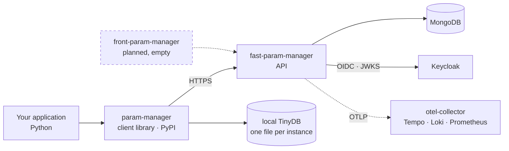

# Architecture

## System context

Who talks to whom, across the whole product:



The two artifacts are released separately, and whatever crosses the arrow
between them is contract — see [Compatibility](compatibilidade.md).

## The server layers

The server is strictly layered, and one rule holds everything together:
**a controller never touches the database.** The full flowchart of a request,
with Keycloak, cryptography and telemetry alongside, is in
[API overview](../api/index.md#how-a-request-crosses-the-api).

Each layer owns something the others are not licensed to take over:

`controllers/`
:   Translates HTTP into a business call. Declares dependencies through
    `Depends` — this is where the decision of who may call what lives. It does
    not know MongoDB exists.

`services/`
:   The rules. `AppService` validates permission, encrypts sensitive values and
    assembles metadata. `RuntimeConfigService` resolves configuration that can
    change without a redeploy.

`repositories/`
:   The only place that talks to Mongo. This is where the conditional write that
    guards against concurrent updates lives.

`models/` and `schemas/`
:   `models/` holds the domain model and, most importantly, the `VALIDATORS`
    dictionary that defines what each parameter type accepts. `schemas/` holds
    the API's request and response contracts.

### Dependency injection is a test contract

The controller module exposes the `get_app_service` factory and re-exports
`get_current_user` and `require_admin`. The test suite overrides **exactly those
names** through `app.dependency_overrides`. Changing how they are imported
breaks the tests without breaking the application — the worst possible order in
which to find out about a problem.

### Concurrency

Concurrent state on the server is versioned by `AppModel.params_version`, a
counter. **Never by `updated_at`.** The two used to be the same field, and while
they were, any date normalization on the audit side turned every write into a
conflict — with a diffuse symptom and no failing test.

## Read resolution in the client

The full flowchart, with all four steps and every exit, is in
[Client overview](../cliente/index.md#how-a-read-is-resolved).

The order is not accidental. Each step costs more than the previous one, and the
last one — TinyDB — exists so that the absence of the API is **degradation**
rather than failure.

Writes have none of this: `create_app`, `upsert_params`, `delete_param` and
`delete_app` always hit the network, always with a token, and never consult the
cache.

## Repository layout

=== "fast-param-manager"

    ```
    fast_param_manager/
    ├── controllers/      # routers: parameter, auth, admin
    ├── services/         # AppService, RuntimeConfigService, AuthService
    ├── repositories/     # AppRepository, RuntimeConfigRepository
    ├── models/           # ParamModel, ParamType, VALIDATORS, AppModel
    ├── schemas/          # request and response contracts
    ├── middlewares/      # keycloak_auth
    ├── core/             # config, database, metrics, logging, dependencies
    └── security/         # crypto_utils
    ```

=== "param-manager"

    ```
    param_manager/
    ├── __init__.py       # exports ParamManager and ParamNaoEncontradoError
    └── manager.py        # the entire library
    ```

    The client is a single module. That is deliberate: it gets bundled inside
    PyInstaller executables, where every extra file is another chance for the
    packager not to find something.

## Where state lives

| State | Where | Lifetime |
|---|---|---|
| Parameters | MongoDB, one document per application | Permanent |
| Read authentication mode | MongoDB, configuration collection | Permanent, editable by an admin |
| Parameter cache | Client process memory | `cache_duration` seconds |
| API error mark | Client process memory | `api_error_cooldown` seconds |
| Survival copy | TinyDB, one file per instance | Until overwritten |
| Keycloak token | Client process memory | Until it expires |
