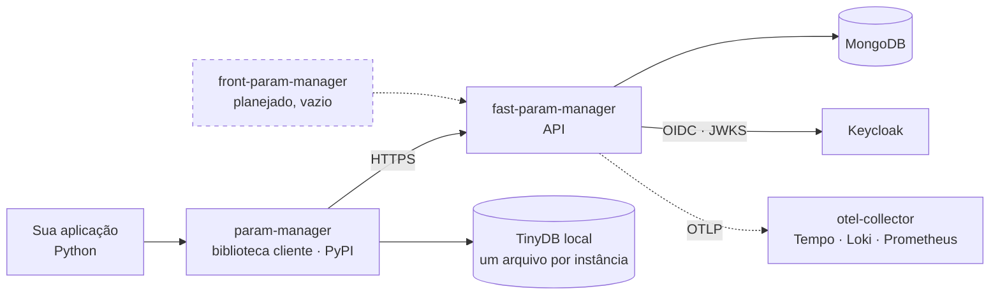

# Arquitetura

## Visão de contexto

Quem fala com quem, no produto inteiro:



Os dois artefatos são liberados separadamente, e o que atravessa a seta entre
eles é contrato — ver [Compatibilidade](compatibilidade.md).

## As camadas do servidor

O servidor é estritamente em camadas, e a regra que sustenta tudo é uma só:
**controller nunca toca no banco.** O fluxograma completo de uma requisição,
com Keycloak, criptografia e telemetria nas laterais, está em
[Visão geral da API](../api/index.md#como-uma-requisicao-atravessa-a-api).

Cada camada tem uma responsabilidade que as outras não têm licença para assumir:

`controllers/`
:   Traduz HTTP em chamada de negócio. Declara as dependências por `Depends` —
    é aqui que mora a decisão de quem pode chamar o quê. Não sabe que MongoDB
    existe.

`services/`
:   As regras. `AppService` valida permissão, cifra valores sensíveis e monta os
    metadados. `RuntimeConfigService` resolve configuração que pode mudar sem
    redeploy.

`repositories/`
:   O único lugar que fala com o Mongo. É aqui que vive a escrita condicional
    que protege contra gravação concorrente.

`models/` e `schemas/`
:   `models/` tem o modelo de domínio e, principalmente, o dicionário
    `VALIDATORS` que define o que cada tipo de parâmetro aceita. `schemas/` tem
    os contratos de entrada e saída da API.

### Injeção de dependência é contrato de teste

O módulo de controller expõe a fábrica `get_app_service` e reexporta
`get_current_user` e `require_admin`. A suíte de testes substitui **exatamente
esses nomes** via `app.dependency_overrides`. Mudar a forma como eles são
importados quebra os testes sem quebrar a aplicação — o que é a pior ordem
possível para descobrir um problema.

### Concorrência

O estado concorrente do servidor é versionado por `AppModel.params_version`, um
contador. **Nunca por `updated_at`.** Os dois já foram o mesmo campo, e enquanto
foram, qualquer normalização de data no lado da auditoria transformava toda
escrita em conflito — com sintoma difuso e nenhum teste falhando.

## A resolução de leitura no cliente

O fluxograma completo, com os quatro degraus e todas as saídas, está em
[Visão geral do cliente](../cliente/index.md#como-uma-leitura-e-resolvida).

A ordem não é acidental. Cada degrau é mais caro que o anterior, e o último
degrau — o TinyDB — existe para que a ausência da API seja **degradação**, e não
falha.

A escrita não tem nada disso: `create_app`, `upsert_params`, `delete_param` e
`delete_app` vão sempre à rede, sempre com token, e nunca consultam cache.

## Estrutura dos repositórios

=== "fast-param-manager"

    ```
    fast_param_manager/
    ├── controllers/      # routers: parameter, auth, admin
    ├── services/         # AppService, RuntimeConfigService, AuthService
    ├── repositories/     # AppRepository, RuntimeConfigRepository
    ├── models/           # ParamModel, ParamType, VALIDATORS, AppModel
    ├── schemas/          # contratos de request e response
    ├── middlewares/      # keycloak_auth
    ├── core/             # config, database, metrics, logging, dependencies
    └── security/         # crypto_utils
    ```

=== "param-manager"

    ```
    param_manager/
    ├── __init__.py       # exporta ParamManager e ParamNaoEncontradoError
    └── manager.py        # a biblioteca inteira
    ```

    O cliente é um módulo só. Isso é deliberado: ele é empacotado dentro de
    executáveis PyInstaller, onde cada arquivo a mais é uma chance a mais de o
    empacotador não encontrar algo.

## Onde o estado vive

| Estado | Onde | Vida útil |
|---|---|---|
| Parâmetros | MongoDB, um documento por aplicação | Permanente |
| Modo de autenticação de leitura | MongoDB, coleção de configuração | Permanente, editável por admin |
| Cache de parâmetros | Memória do processo cliente | `cache_duration` segundos |
| Marca de erro da API | Memória do processo cliente | `api_error_cooldown` segundos |
| Cópia de sobrevivência | TinyDB, um arquivo por instância | Até ser sobrescrita |
| Token do Keycloak | Memória do processo cliente | Até expirar |
