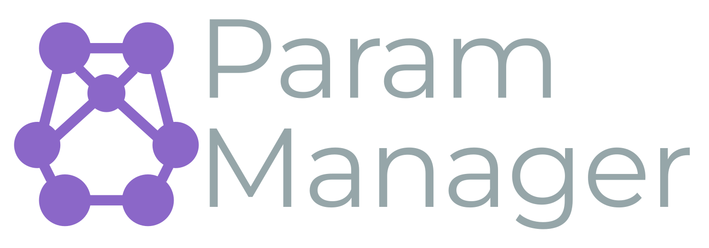

# Param Manager

<!-- Sintaxe Markdown, e não : o mkdocs reescreve o caminho relativo
     de imagem em Markdown para cada página, e o build em inglês fica em
     /en/. Um src fixo em HTML apontaria para /en/assets/, que não existe
     — os assets ficam só na raiz do site.

     Este é o cartaz: o quadro final da animação, parado. É o que aparece
     antes de o desenho animado chegar, o que fica para quem pediu menos
     movimento ao sistema, e o que volta quando a animação acaba — o
     último quadro do arquivo gerado limpa o SVG, então sem o cartaz a
     área terminaria vazia. -->

<svg id="LogoAnimation" class="pm-marca__tela" viewBox="219 280 1482 519" aria-hidden="true" hidden></svg>

## Parâmetros centralizados, com segredo cifrado e leitura que não cai

O Param Manager tira a configuração de dentro do `.env` de cada máquina e a
coloca num único lugar, versionado e auditável — sem que a aplicação passe a
depender de a rede estar de pé no instante da leitura.

O produto são **dois artefatos entregues separadamente** e um contrato entre
eles:

<ul class="pm-cartoes">
<li><a class="pm-cartao" href="api/">
  fast-param-manager — a API
  Servidor FastAPI sobre MongoDB, autenticado por Keycloak. Guarda os parâmetros, valida o tipo de cada um, cifra os sensíveis e decide quem pode escrever o quê.
</a></li>
<li><a class="pm-cartao" href="cliente/">
  param-manager — o cliente
  Biblioteca Python publicada no PyPI. Lê os parâmetros, mantém cache em memória, decifra os segredos e continua respondendo com dado local quando a API não responde.
</a></li>
<li><a class="pm-cartao" href="seguranca/envelope/">
  O envelope criptográfico
  O formato em que um segredo é gravado. É contrato congelado: os dois lados implementam a mesma coisa em repositórios que são liberados em datas diferentes.
</a></li>
</ul>

## Por onde começar

| Se você quer… | Vá para |
|---|---|
| Entender o produto antes do código | [Visão geral](produto/visao-geral.md) |
| Ver como uma requisição atravessa o sistema | [Arquitetura](produto/arquitetura.md) |
| Subir a API na sua máquina | [Instalação e execução](api/instalacao.md) |
| Consumir os parâmetros de uma aplicação Python | [Uso do cliente](cliente/uso.md) |
| Saber o que pode quebrar quem já está em produção | [Compatibilidade](produto/compatibilidade.md) |
| Guardar senha ou credencial num parâmetro | [Envelope criptográfico](seguranca/envelope.md) |

## O que esta documentação assume

Que você vai ler o código quando a resposta importar de verdade. Todas as
páginas aqui foram escritas conferindo a implementação, e onde o comportamento
é surpreendente isso está dito na página em vez de escondido. Quando houver
divergência entre o que está escrito aqui e o que o código faz, **o código está
certo** — e a página está com defeito, o que é um problema a ser reportado.

!!! note "Cada página pode ser levada embora"

    O botão **Baixar .md** entrega o arquivo Markdown original, exatamente como
    está no repositório. O **Salvar em PDF** abre a caixa de impressão do
    navegador com uma folha de estilo que remove a navegação — o que sai é só o
    conteúdo. Os dois estão na barra superior de toda página, junto do seletor
    de fonte, e a documentação inteira existe em português e inglês.
